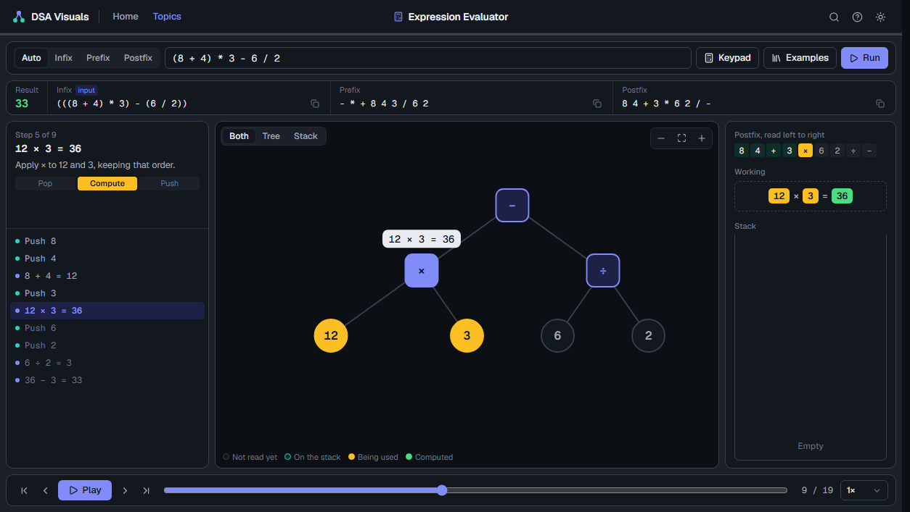
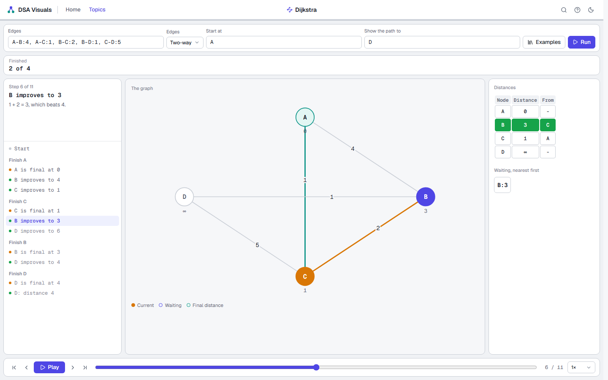
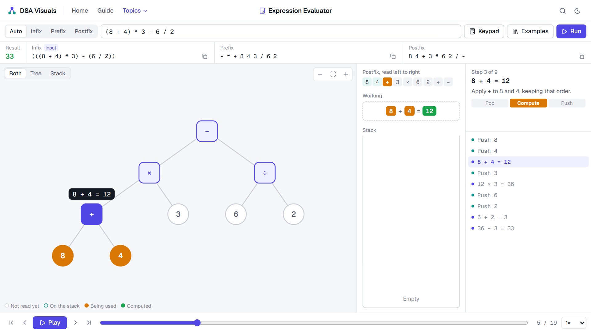
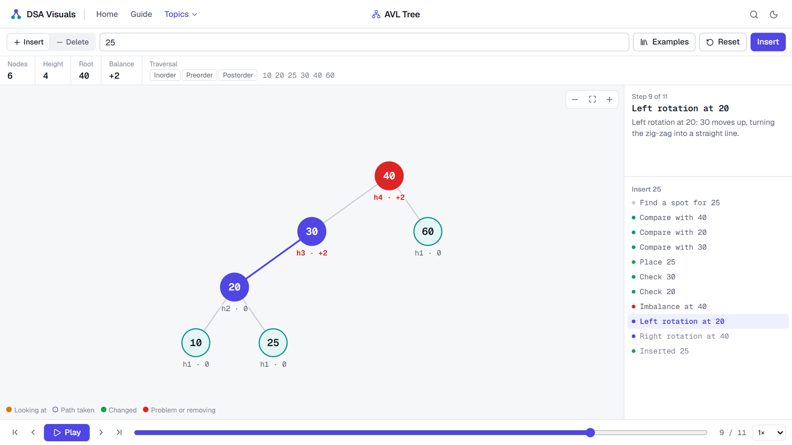
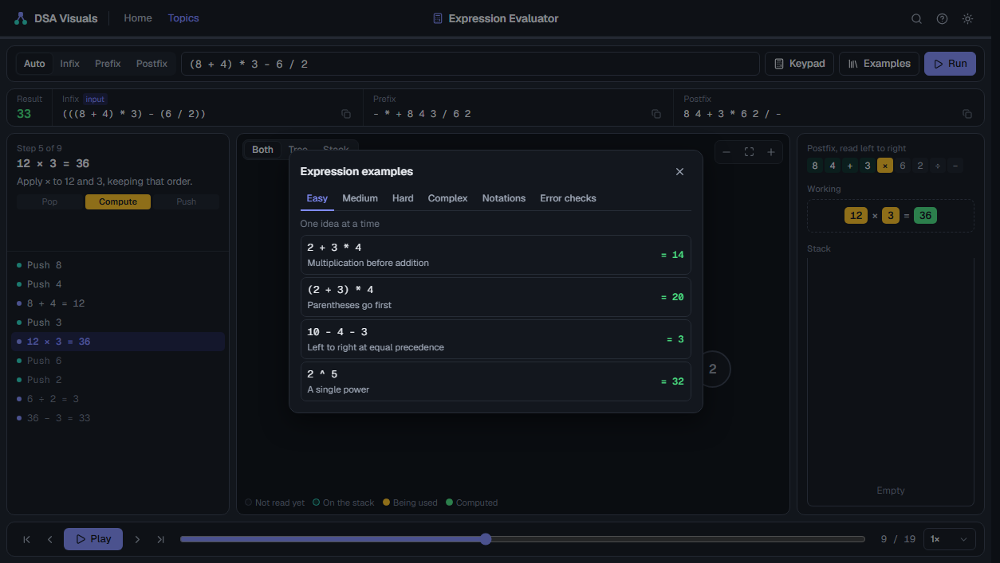
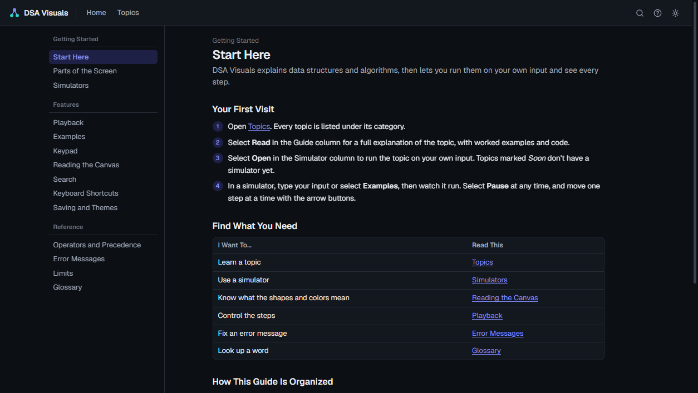
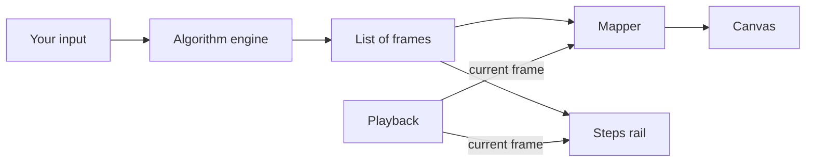

<div align="center">

# DSA Visuals

**See how data structures and algorithms actually work.**

Enter your own input and step through every operation, as values merge, stacks move, and trees rotate.




</div>

## Why it's different

Most visualizers show you the result. DSA Visuals shows you the work, down to the single operation.

- **Operators visibly resolve.** Two values are picked, the sum is shown, and the children slide into their parent as it changes from a square operator into a round value.
- **Trees move instead of redrawing.** Every node glides to its new position, so you can follow a rotation with your eyes.
- **Every step explains itself.** A side rail says what is happening and why, and you can jump to any step.
- **Your input, not canned demos.** Type anything and it runs, or pick from examples sorted by difficulty.

## What's inside

### Topic Guides

Every one of the 111 topics has its own long-form guide at `/topics/<topic>`, explaining what it is, how it works, and why, with worked examples, runnable Python, complexity tables, and common mistakes. Its sidebar shows the topic's category and sections, follows you as you read, and links back to Topics and on to the simulator. The Topics page links to each guide, and to its simulator once that tool is built.

### Simulators

<div align="center">



</div>

Every one of the 111 topics has a simulator. Each page shows what suits its topic, such as boxes for an array, linked nodes for a list, bars for sorting, buckets for hashing, a table for dynamic programming, a graph for shortest paths, pegs for the Tower of Hanoi, a timeline for job scheduling, or a console of results. Only the inputs that apply are shown, and many topics let you switch method, such as the pivot rule in quick sort, or any of the six conversions between infix, prefix, and postfix.

### Expression Evaluator

<div align="center">



</div>

| Feature | Details |
| --- | --- |
| **Input** | Infix, prefix, or postfix, with automatic detection. Type or use the keypad. |
| **Conversions** | All three notations, side by side, with one-click copy. |
| **Evaluation** | Each operator is split into three phases: pop, compute, and push. |
| **Expression tree** | Collapses upward in step with the stack, until only the answer is left. |
| **Language** | `+ - * / ^`, parentheses, unary minus, decimals, and implicit multiplication such as `2(3 + 4)`. |
| **Validation** | Specific errors that name the problem, like `Division by zero: 1 ÷ 0 is undefined`. |

### Expression Tools

Two tools that use a stack to draw and check expressions, each with its own page, examples, and saved input. Converting between notations is one of the simulators below.

| Tool | What You See |
| --- | --- |
| **Expression Tree** | Subtrees joining on a stack until one tree is left, plus inorder, preorder, and postorder walks. |
| **Balanced Parentheses** | A stack checking `( ) [ ] { }`, with matched pairs colored and the exact problem named. |

### Binary Search Tree

| Feature | Details |
| --- | --- |
| **Insert and delete** | One value or a whole list. Lists are checked first, so a bad value changes nothing. |
| **Search path** | Comparisons appear on the node they happen at, and the path taken is highlighted. |
| **Deletion** | Leaf, one child, and two children (inorder successor), each shown step by step. |
| **Traversals** | Inorder, preorder, and postorder play out node by node. |

### AVL Tree

<div align="center">



</div>

| Feature | Details |
| --- | --- |
| **Balancing** | Height and balance on every node, with the imbalance shown and named before it's fixed. |
| **Rotations** | All four cases: Left-Left, Right-Right, Left-Right, and Right-Left. |
| **Its own page** | Each tree has its own page and keeps its own saved tree. |

### Across the Whole App

<table>
<tr>
<td width="50%"></td>
<td width="50%"></td>
</tr>
<tr>
<td><strong>Examples by level.</strong> Easy, Medium, Hard, and Complex, plus Notations and Error checks. Tucked away in a box until you want them.</td>
<td><strong>A help guide.</strong> How to use the tools, with every control, error message, and limit explained.</td>
</tr>
</table>

- **Search:** find any topic, section of a topic guide, tool, or help page from the navbar, or with <kbd>Ctrl</kbd> <kbd>K</kbd>.
- **Playback:** play, pause, step, scrub, and set the speed from 0.5× to 4×.
- **Keyboard:** <kbd>←</kbd> <kbd>→</kbd> to step, <kbd>Space</kbd> to play, <kbd>Enter</kbd> to run, and <kbd>Esc</kbd> to clear.
- **One-screen workspaces:** no page scrolling on desktop, and a stacked layout on phones.
- **Custom controls:** styled scrollbars and dropdowns everywhere, and pages never shift sideways when a scrollbar appears.
- **Light and dark themes:** follows your system until you choose. Respects reduced-motion settings.
- **Saved automatically:** your input and trees are kept in this browser.

## Getting started

You need [Node.js](https://nodejs.org) 20.9 or newer and [pnpm](https://pnpm.io).

```bash
pnpm install
```

```bash
pnpm dev
```

Then open [http://localhost:3000](http://localhost:3000). No database, API keys, or environment variables are needed, because everything runs in the browser.

### Commands

| Command | What it does |
| --- | --- |
| `pnpm dev` | Start the development server |
| `pnpm build` | Create a production build |
| `pnpm start` | Serve the production build |
| `pnpm test` | Run the algorithm tests |
| `pnpm typecheck` | Check types without building |

### Try these

| Module | Input | Watch for |
| --- | --- | --- |
| Notation Conversion | `2 ^ 3 ^ 2` | The second `^` waiting instead of popping |
| Merge Sort | `38, 27, 43, 3` | Two sorted halves merging into one |
| Dijkstra | `A-B:4, A-C:1, B-C:2, B-D:1, C-D:5` | A shortcut beating the direct edge |
| N-Queens | Board size `4` | Backtracking out of dead ends |
| Balanced Parentheses | `([)]` | The stack catching what a counter would miss |
| Expressions | `(8 + 4) * 3 - 6 / 2` | The tree collapsing into `33` |
| Expressions | `2 ^ 3 ^ 2` | Powers grouping from the right, giving `512` |
| Expressions | `5 1 2 + 4 * + 3 -` | Postfix detected automatically, giving `14` |
| AVL | Insert `30, 10, 20` | A Left-Right double rotation |
| AVL | Insert `1, 2, 3, 4, 5, 6, 7` | Sorted input staying perfectly balanced |
| BST | Insert `10, 20, 30, 40, 50` | Why sorted input ruins a plain BST |

## How it's built

The algorithms are plain TypeScript with no dependency on the UI, which keeps them easy to test. Each one records its work as a list of **frames**, and the UI only draws the current frame. That one idea gives you playback, stepping backward, and animation for free.



```text
src/
├── app/                    Routes: home, topics, topics/[slug], simulate/[slug], expressions, expressions/[topic], trees/[type], guide/[slug], plus 404, error, and loading
├── components/
│   ├── site/               Navbar, logo, dropdown, topics sidebar, side panel
│   ├── simulator/          The page every shared simulator uses, and the views it can draw: boxes, bars, tables, graphs, charts, and more
│   ├── visual/             Shared: tree canvas, playback, steps rail, stack, live demo
│   ├── workspace/          One workspace per module, the shell the expression tools share, and the examples box
│   ├── guide/              Help guide sidebar
│   └── topic-guide/        Topic guide body and sidebar
├── content/
│   ├── examples.ts         Example sets by level
│   ├── guide.tsx           Help pages
│   ├── topic-guides/       One Markdown guide per topic
│   ├── topic-guides.ts     Reads a topic's guide
│   └── search-index.ts     Turns topics, topic guides, and help pages into search entries
├── simulators/
│   ├── kit.ts              Shared parts: input fields, input readers, the step recorder, and view builders
│   ├── registry.ts         Which file holds each topic, so only one category loads at a time
│   └── foundations.ts …    One file per category, each holding its topics' logic
└── lib/
    ├── catalog.ts          Every category and topic
    ├── guide-markdown.ts   Reads the Markdown that topic guides are written in
    ├── expressions.ts      Parsing, conversion, and evaluation
    ├── expression-frames.ts  Evaluation steps as animation frames
    ├── expression-tree.ts  Building a tree from postfix, and walking it
    ├── shunting-yard.ts    Infix to postfix, with a frame for each decision
    ├── balanced-brackets.ts  Bracket checking with a stack
    ├── search.ts           Ranking and snippets for search results
    ├── trees.ts            BST and AVL operations, traversals
    ├── use-active-section.ts  Which section to highlight in a sidebar
    ├── use-playback.ts     Playback state and keyboard controls
    └── use-saved-state.ts  All saved data goes through here
tests/                      Algorithm, frame, and example tests
```

### Adding a new simulator

Most simulators are a definition object, with no page of their own.

1. In the category's file in `src/simulators`, write the fields it needs, some examples, and a `run` function. `run` reads the input and returns a list of frames, and each frame lists the views to draw.
2. Add its slug to `SLUGS` in `src/simulators/registry.ts`. The page at `/simulate/<slug>`, the Topics page, and search all pick it up on their own.
3. Add its known answers and a check against a slow, simple solution to `tests/simulators.test.ts`.

The kit already has boxes, bars, tables, linked nodes, stacks, buckets, graphs, trees, pegs, charts, timelines, logs, and facts. To add a new kind of view, add it to the `Panel` type in `kit.ts`, and draw it in `src/components/simulator/panels.tsx`.

A topic that needs controls of its own, like the Expression Evaluator, can have its own workspace in `src/components/workspace` and its own route. Set its address as the topic's `simulator` value in `src/lib/catalog.ts`.

### Editing a topic guide

Each guide is one Markdown file in `src/content/topic-guides`, named after its topic. It starts with `> summary`, and `[[Topic]]` links to another guide. The tests fail on a missing guide, a broken link, or a thin page.

## Testing

```bash
pnpm test
```

Every simulator runs on its starting input, every example, and every option, and each step is checked for broken output. Each one's answers are compared with known textbook results, and on thousands of random inputs with a slow, simple solution: every sort with `Array.sort`, Dijkstra with Bellman-Ford and Floyd-Warshall, Kruskal and Prim with every possible spanning tree, the knapsacks with every subset, and so on. All six notation conversions must match the evaluator's own parser on hundreds of random expressions. Every topic guide is checked for completeness and working links. The tests also cover precedence and associativity, round trips between all three notations, error messages, and the frame-by-frame collapse. For trees, randomized runs check ordering, stored heights, and uniqueness in every intermediate frame, not only the final tree. Every example in the app is run too, and its documented result is checked.

## Roadmap

The Topics page in the app lists 111 topics in 10 categories, chosen around what bachelor's courses in data structures and algorithms teach. Every topic has a guide and a simulator.

| Area | Topics | Covers |
| --- | ---: | --- |
| **Foundations** | 15 | Abstract data types, Big-O growth, time-space tradeoff, recursion, GCD, recurrences, bit manipulation, P vs NP |
| **Linear Structures** | 10 | Arrays, strings, linked lists, stacks, queues, deques, bit arrays |
| **Hashing** | 8 | Hash functions, hash tables, collision handling, sets and maps, string hashing |
| **Searching** | 5 | Linear and binary search, naive pattern matching, KMP, Rabin-Karp |
| **Sorting** | 10 | Bubble, selection, insertion, merge, quick, heap, counting, radix, bucket |
| **Trees and Heaps** | 8 | Binary tree basics, traversals, BST, AVL, heaps, priority queues, binomial heaps |
| **Graphs** | 18 | Graph basics, BFS, DFS, shortest paths, spanning trees, topological sort, union-find, graph coloring, A* search, min cut |
| **Problem-Solving Techniques** | 13 | Divide and conquer, greedy, backtracking, N-Queens, minimax, alpha-beta pruning, hill climbing |
| **Dynamic Programming** | 20 | Memoization, rod cutting, assembly line scheduling, knapsack, LCS, edit distance, optimal BST |
| **Expressions** | 4 | Evaluation, notation conversion, balanced parentheses, expression trees |
| **Platform** | Not a topic | User accounts, saving to the cloud, shareable links |

## Conventions

- Unary minus applies after powers, as in standard math: `-2^2` is `-4`, and `(-2)^2` is `4`.
- In prefix and postfix, separate every token with a space and write unary minus as `~`.
- Tree height counts nodes: an empty tree has height 0 and a single node has height 1.
- Duplicate tree values are ignored.
- Limits: expressions up to 500 characters, Balanced Parentheses input up to 200, tree values within ±999999, 40 values per operation, and 63 values per tree.
- Arithmetic uses double-precision floating point, and results show up to 12 significant digits.
