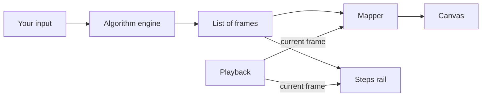

<div align="center">

# DSA Visuals

**See how data structures and algorithms actually work.**

Enter your own input and step through every operation, as values merge, stacks move, and trees rotate.


</div>

## Why it's different

Most visualizers show you the result. DSA Visuals shows you the work, down to the single operation.

- **Operators visibly resolve.** Two values are picked, the sum is shown, and the children slide into their parent as it changes from a square operator into a round value.
- **Trees move instead of redrawing.** Every node glides to its new position, so you can follow a rotation with your eyes.
- **Every step explains itself.** A side rail says what is happening and why, and you can jump to any step.
- **Your input, not canned demos.** Type anything and it runs, or pick from examples sorted by difficulty.

## What's inside

### Expression Evaluator


| Feature | Details |
| --- | --- |
| **Input** | Infix, prefix, or postfix, with automatic detection. Type or use the keypad. |
| **Conversions** | All three notations, side by side, with one-click copy. |
| **Evaluation** | Each operator is split into three phases: pop, compute, and push. |
| **Expression tree** | Collapses upward in step with the stack, until only the answer is left. |
| **Language** | `+ - * / ^`, parentheses, unary minus, decimals, and implicit multiplication such as `2(3 + 4)`. |
| **Validation** | Specific errors that name the problem, like `Division by zero: 1 ÷ 0 is undefined`. |

### Binary Search Tree

| Feature | Details |
| --- | --- |
| **Insert and delete** | One value or a whole list. Lists are checked first, so a bad value changes nothing. |
| **Search path** | Comparisons appear on the node they happen at, and the path taken is highlighted. |
| **Deletion** | Leaf, one child, and two children (inorder successor), each shown step by step. |
| **Traversals** | Inorder, preorder, and postorder play out node by node. |

### AVL Tree


| Feature | Details |
| --- | --- |
| **Balancing** | Height and balance on every node, with the imbalance shown and named before it's fixed. |
| **Rotations** | All four cases: Left-Left, Right-Right, Left-Right, and Right-Left. |
| **Its own page** | Each tree has its own page and keeps its own saved tree. |

### Across the Whole App

<table>
<tr>
<td width="50%"></td>
<td width="50%"></td>
</tr>
<tr>
<td><strong>Examples by level.</strong> Easy, Medium, Hard, and Complex, plus Notations and Error checks. Tucked away in a box until you want them.</td>
<td><strong>A real guide.</strong> Pick a module on the left, read it in the center, and jump between its parts on the right.</td>
</tr>
</table>

- **Coming Soon pages:** every unbuilt topic has a page saying what it will cover and what's ready now.
- **Search:** find any topic, tool, or guide section from the navbar, or with <kbd>Ctrl</kbd> <kbd>K</kbd>.
- **Playback:** play, pause, step, scrub, and set the speed from 0.5× to 4×.
- **Keyboard:** <kbd>←</kbd> <kbd>→</kbd> to step, <kbd>Space</kbd> to play, <kbd>Enter</kbd> to run, and <kbd>Esc</kbd> to clear.
- **One-screen workspaces:** no page scrolling on desktop, and a stacked layout on phones.
- **Light and dark themes:** follows your system until you choose. Respects reduced-motion settings.
- **Saved automatically:** your input and trees are kept in this browser.

## Getting started

You need [Node.js](https://nodejs.org) 20.9 or newer and [pnpm](https://pnpm.io).

```bash
pnpm install
```

```bash
pnpm dev
```

Then open [http://localhost:3000](http://localhost:3000). No database, API keys, or environment variables are needed, because everything runs in the browser.

### Commands

| Command | What it does |
| --- | --- |
| `pnpm dev` | Start the development server |
| `pnpm build` | Create a production build |
| `pnpm start` | Serve the production build |
| `pnpm test` | Run the algorithm tests |
| `pnpm typecheck` | Check types without building |

### Try these

| Module | Input | Watch for |
| --- | --- | --- |
| Expressions | `(8 + 4) * 3 - 6 / 2` | The tree collapsing into `33` |
| Expressions | `2 ^ 3 ^ 2` | Powers grouping from the right, giving `512` |
| Expressions | `5 1 2 + 4 * + 3 -` | Postfix detected automatically, giving `14` |
| AVL | Insert `30, 10, 20` | A Left-Right double rotation |
| AVL | Insert `1, 2, 3, 4, 5, 6, 7` | Sorted input staying perfectly balanced |
| BST | Insert `10, 20, 30, 40, 50` | Why sorted input ruins a plain BST |

## How it's built

The algorithms are plain TypeScript with no dependency on the UI, which keeps them easy to test. Each one records its work as a list of **frames**, and the UI only draws the current frame. That one idea gives you playback, stepping backward, and animation for free.



```text
src/
├── app/                    Routes: home, topics, topics/[slug], expressions, trees/[type], guide/[slug], plus 404, error, and loading
├── components/
│   ├── site/               Navbar, logo, topic rows, topics sidebar, scroll area
│   ├── visual/             Shared: tree canvas, playback, steps rail, stack, live demo
│   ├── workspace/          One workspace per module, plus the examples box
│   └── guide/              Guide sidebar and right column
├── content/
│   ├── examples.ts         Example sets by level
│   ├── guide.tsx           Guide pages (both guide columns are built from these)
│   ├── search-index.ts     Turns topics and guide pages into search entries
│   └── topic-notes.ts      One line on each unbuilt topic, for its Coming Soon page
└── lib/
    ├── catalog.ts          Every category and topic, with its level and status
    ├── expressions.ts      Parsing, conversion, and evaluation
    ├── expression-frames.ts  Evaluation steps as animation frames
    ├── search.ts           Ranking and snippets for search results
    ├── trees.ts            BST and AVL operations, traversals
    ├── use-active-section.ts  Which section to highlight in a sidebar
    ├── use-playback.ts     Playback state and keyboard controls
    └── use-saved-state.ts  All saved data goes through here
tests/                      Algorithm, frame, and example tests
```

### Adding a new module

1. Write the algorithm in `src/lib` so it returns a list of frames, and test it.
2. Add a workspace in `src/components/workspace`, reusing the playback bar and steps rail.
3. Add a route in `src/app`.
4. Add an `href` to its topic in `src/lib/catalog.ts`. The Topics page, Topics menu, and navbar title update on their own, and its "Soon" label goes away.
5. Add its pages and examples in `src/content`.

## Testing

```bash
pnpm test
```

The tests cover precedence and associativity, round trips between all three notations, error messages, and the frame-by-frame collapse. For trees, randomized runs check ordering, stored heights, and uniqueness in every intermediate frame, not only the final tree. Every example in the app is run too, and its documented result is checked.

## Roadmap

The Topics page in the app lists every planned topic, grouped by category and level.

| Area | Planned |
| --- | --- |
| **Foundations** | Big-O growth, best and worst case, recursion, bit manipulation |
| **Linear Structures** | Arrays, strings, linked lists, stacks, queues, deques, matrices |
| **Hashing** | Hash tables, collision handling, sets and maps |
| **Searching** | Linear search, binary search |
| **Sorting** | Bubble, selection, insertion, merge, quick, heap, counting, radix, bucket |
| **Trees** | Binary tree basics, heaps, priority queues, tries, red-black, B-trees, segment and Fenwick trees |
| **Graphs** | BFS, DFS, shortest paths, spanning trees, topological sort, union-find, flow |
| **Problem-Solving Techniques** | Two pointers, sliding window, divide and conquer, greedy, backtracking |
| **Dynamic Programming** | Memoization, knapsack, coin change, LCS, edit distance |
| **String Algorithms** | KMP, Rabin-Karp, Boyer-Moore, suffix arrays, regex matching |
| **Expressions and Parsing** | Infix-to-postfix conversion, tokenizing |
| **In Real Systems** | LRU cache, Bloom filter, skip list, consistent hashing, database indexes, LSM trees |
| **Platform** | User accounts, saving to the cloud, shareable links |

## Conventions

- Unary minus applies after powers, as in standard math: `-2^2` is `-4`, and `(-2)^2` is `4`.
- In prefix and postfix, separate every token with a space and write unary minus as `~`.
- Tree height counts nodes: an empty tree has height 0 and a single node has height 1.
- Duplicate tree values are ignored.
- Limits: expressions up to 500 characters, tree values within ±999999, 40 values per operation, and 63 values per tree.
- Arithmetic uses double-precision floating point, and results show up to 12 significant digits.
